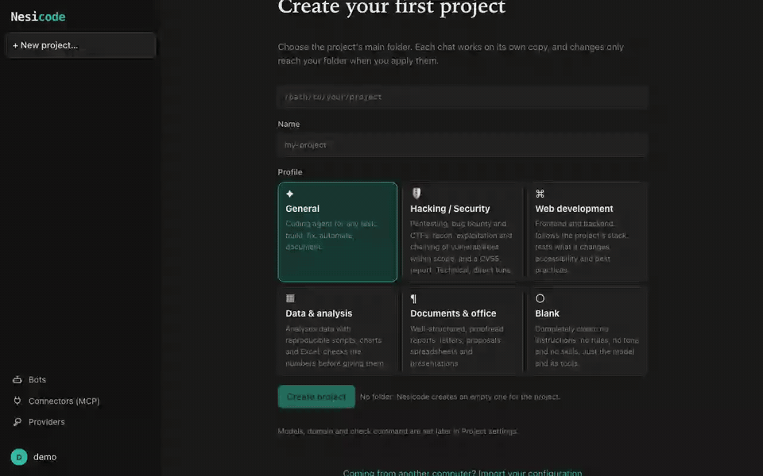
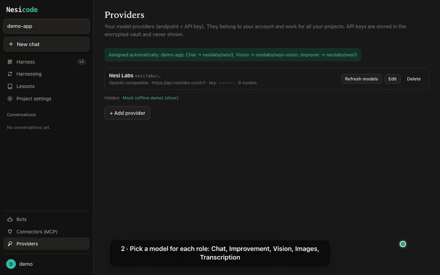
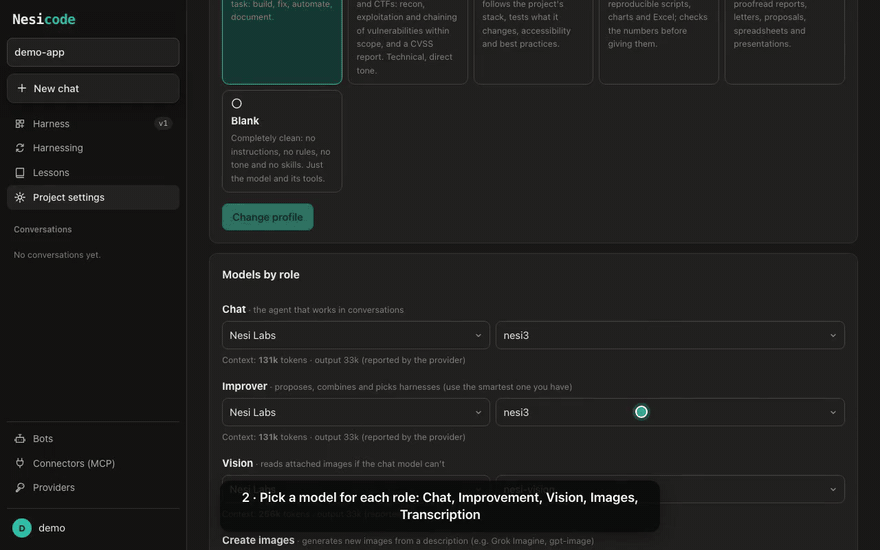
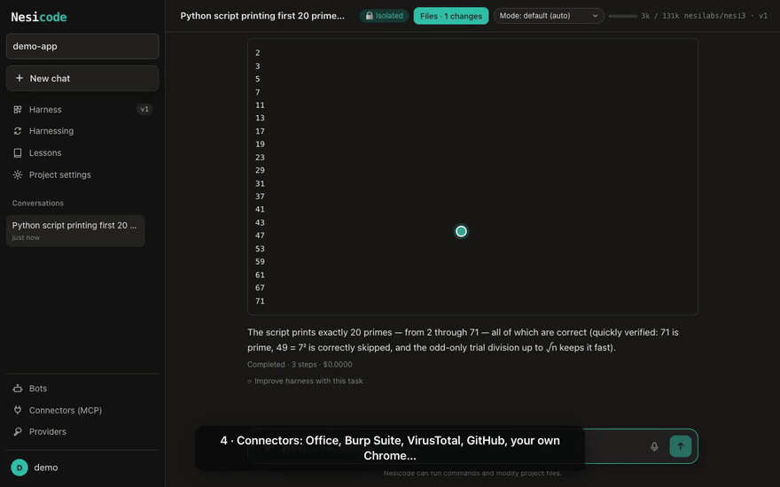
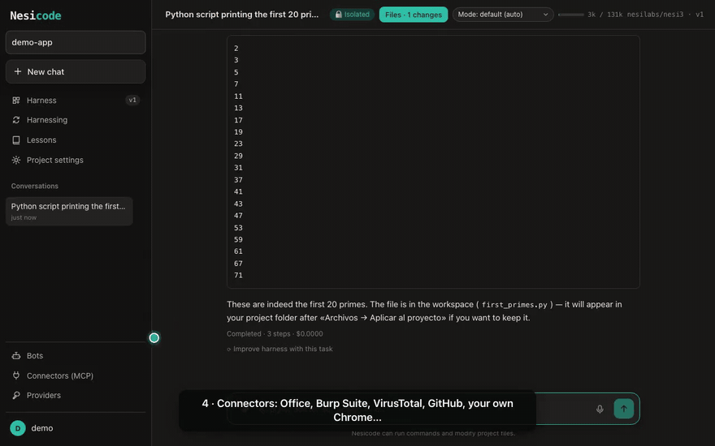
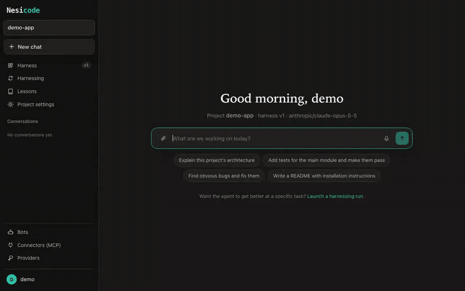

# Nesicode

A coding agent that **improves its own harness** task by task, with a multi-user web interface and desktop apps.



▶ [Watch the quick-start video (MP4, 96 s)](docs/demo/nesicode-demo.mp4) — pick a project profile, add your API key, choose a model for each role, chat, connectors and bots.

## Quick tour

<details open>
<summary><b>1 · Create a project, pick a profile (General, Security, Web, Data, Documents or Blank) and add your provider + API key</b> (<a href="docs/demo/clips/1-setup.mp4">MP4</a>)</summary>


</details>

<details>
<summary><b>2 · Pick a model for each role</b> — Chat, Improvement, Vision, Images, Transcription (<a href="docs/demo/clips/2-models.mp4">MP4</a>)</summary>


</details>

<details>
<summary><b>3 · Ask for something</b> — it writes files and runs commands in its sandbox (<a href="docs/demo/clips/3-chat.mp4">MP4</a>)</summary>


</details>

<details>
<summary><b>4 · Connectors</b> — Office, Burp Suite, VirusTotal, GitHub, your own Chrome… used only when you ask (<a href="docs/demo/clips/4-connectors.mp4">MP4</a>)</summary>


</details>

<details>
<summary><b>5 · Bots</b> — tasks that run on their own (<a href="docs/demo/clips/5-bots.mp4">MP4</a>)</summary>


</details>

<details>
<summary><b>How to add providers and pick models</b> — templates (Nesi Labs, Claude, OpenAI, OpenRouter, Gemini, GLM, Grok, DeepSeek, Ollama or any OpenAI-compatible API), test the connection, discover its models, models by role, export / import to another computer (<a href="docs/demo/providers.mp4">MP4, 80 s</a>)</summary>


</details>

The model's weights never change: what gets optimized is the system around it (instructions, rules, memory,
skills, sub-agents, scripts and hooks).

## How it works

**Harness**: 8 editable, versioned components per project.

| File | What it is | When it is in context |
|---|---|---|
| `system_prompt.md` | role and procedure | always |
| `guardrails.md` | permanent rules | always |
| `memory.md` | project facts | always |
| `tool_guidance.md` | how to use the tools | always |
| `skills/<n>/SKILL.md` | reusable workflow | on demand (`load_skill`) |
| `sub_agents/<n>/AGENT.md` | sub-agent with its own context | via `delegate` |
| `scripts/<f>.py` | deterministic helper | via bash in `.nesicode/` |
| `plugins/hooks.json` | declarative hooks (block, warn, add a hint, trim) | inside the loop |

**Harnessing (Propose → Probe → Compose)** on a task, with a budget `k`:

1. **Base**: `k` runs with the current harness, each in an isolated copy of the workspace.
2. **Propose**: **INV** candidates (how the agent works) and **DOM** candidates (what it knows about the domain and the code).
3. **Probe**: each candidate runs once on the same task. If you set a check command (tests), it runs after every attempt.
4. **Compose**: a final harness is assembled from the contrasts between trajectories.
5. **Select**: a blind selector picks the best result without knowing which harness produced it.
6. **Reflect**: at most one transferable lesson is stored in the domain's library.

**Parallel** mode (explores breadth) or **sequential** mode (refines depth). Both use 4k agent runs and 3k improvement stages.

Applying and adopting never undo your own work: when a run's file changes are applied (automatically or with
"Apply"), a file you changed after the run started is left as it is and the proposed version is written next to it
as `<file>.nesicode-new`; when its harness is adopted (automatically or with "Adopt"), edits made to the harness
meanwhile are merged in, and if both changed the same file nothing is adopted and you are told what to do.

## Quick start

```bash
uv sync
cd web && npm install && npm run build && cd ..
cp .env.example .env            # add at least one API key
uv run nesicode serve           # http://127.0.0.1:8420
```

Web development with hot reload: `uv run nesicode serve --reload` and, in another terminal, `cd web && npm run dev` (http://localhost:5173, proxies `/api` to the backend).

Demo with no keys and no cost (`mock` provider):

```bash
uv run nesicode demo --k 1                                    # full harnessing in the terminal
NESICODE_DATA_DIR=./data uv run python scripts/seed_dev.py    # test user and project for the web UI
```

CLI:

```bash
uv run nesicode run "fix the failing test" --workspace ./my-repo --model anthropic/claude-opus-5-5
uv run nesicode harness "add pagination to /users" --workspace ./my-repo --k 2 --mode sequential --check "uv run pytest -q" --apply
```

## Desktop app (macOS and Windows)

A single program: it starts the server on a private port and opens it in its own window (WebKit on Mac,
WebView2 on Windows). No login, but a random token per launch so other programs on the computer cannot use
its API. Data lives in `~/Library/Application Support/nesicode` (Mac) or `%APPDATA%\nesicode` (Windows);
optional configuration goes in a `.env` inside that folder.

Closing the window stops the replies in progress (they are kept as interrupted; queued messages wait for the next
launch) and every MCP server the app started.

- **macOS**: `packaging/build_macos.sh` → `dist/Nesicode.app` and `dist/Nesicode-<version>-macos-<arch>.dmg`.
  Ad-hoc signed (no Apple Developer ID): the first time, right-click → Open.
- **Windows**: `packaging/windows/build.ps1` (on Windows, with Inno Setup 6) → `dist\Nesicode-<version>-windows-x64-setup.exe`,
  a per-user install with no admin rights. On Windows there is no OS cage unless you use Docker; the agent uses
  Git for Windows' bash if installed, or PowerShell. Each of its commands runs in a job object of its own, so Stop,
  a timeout and the end of the reply end everything the command started, also what it left running in the
  background (as process groups do on macOS/Linux); local MCP servers (`npx`, `uvx`…) get the same from the MCP SDK.
- **GitHub Actions** (`.github/workflows/desktop.yml`): builds both (Mac Apple Silicon + Windows) on demand from
  the Actions tab or when a `v*` tag is pushed, and attaches them to the release.
- From source: `uv sync --extra desktop && uv run nesicode desktop`.

Downloads are on the [Releases](../../releases) page.

## Features

- **Chat** with streaming, attachments and paste, image viewer, message queue (with × to remove queued
  messages), instant stop, ↑ to recall previous messages, and **microphone dictation** (macOS built-in speech
  recognition, or any Whisper-compatible model).
- **Per-role models**: Chat, Improvement, Vision, Image generation and Transcription.
- **Execution permissions**: auto, ask before commands, or ask before everything, with per-conversation approvals.
- **Connectors (MCP)**: one-click gallery (Chrome DevTools, Playwright, GitHub, Microsoft 365 roadmap, Burp Suite)
  plus custom stdio/HTTP servers, and built-in connectors that need nothing installed:
  **Office** (Word, Excel with formulas and charts, PowerPoint), **VirusTotal** (hashes, URLs, domains, IPs) and
  **Burp Suite REST API** for older versions. Each connector has a usage mode: *only when I ask for it* (default:
  "audit this site" won't fire Burp, "use Burp to audit this site" will), *whenever useful*, or *always ask me*.
- **Bots**: tasks that run on their own — on a schedule, when a web page changes, from Telegram or by webhook —
  each one a conversation you can also talk to. Create them from a plain-language description or from any chat.
- **Your own Chrome**: a Chrome extension lets the agent use only the tabs in a "Nesicode" tab group.
- **Telegram**: drive your conversations from a Telegram bot (attach/detach chats, approvals, files).
- **Context management** for long tasks: large outputs saved to disk; old tool results set aside (each marker says
  how to read it again) while the newest stay whole; structured summaries that keep the user's rules from earlier
  turns, the files the agent read and the results it has not seen yet; the model's reasoning sent back within a task
  for models that build on it (nesi3, GLM, Qwen, DeepSeek); a reminder to write results down as it goes; and a
  per-conversation archive (every turn, with its reasoning) searchable with `search_history`. Stop and *continue*
  pick the work up where it was left. Context limits are discovered per model; a limit learned from a provider's
  error is kept until you forget it (e.g. after giving a local server a bigger window).
- **Export / import configuration**: providers with their keys, connectors, preferences, bots and a project
  template, in a password-encrypted file, to move everything to another computer. The import shows what it will
  change first, and a file never switches anything on behind your back: local MCP servers (commands) and bots with
  a schedule arrive switched off until you review them, approvals are never loosened (execution mode, connector
  usage, a bot's `auto` policy), and a stored API key is never sent to an endpoint the file changed.
- **English and Spanish** UI.

## Models

`provider/model` format, configurable per project:

`nesilabs/nesi3` (api.nesilabs.com, default) · `anthropic/claude-opus-5-5` · `openai/<model>` · `openrouter/z-ai/glm-5` · `gemini/gemini-3.5-flash` · `zai/glm-5` ·
`xai/<model>` · `deepseek/<model>` · `ollama/<model>` · `compat/<model>` (any OpenAI-compatible API) · `mock/demo`.

Each user can store their own keys from the web UI (encrypted). Without them, the server's keys (`.env`) are used.
Claude is called through the official SDK, with adaptive thinking and `fallbacks: "default"` on models that support it.

Replies are streamed. A request that fails on the way (rate limit, overloaded server, dropped connection, a reply the
server stops as `length` after a handful of tokens) is tried up to 8 times in all, with backoff (honouring
`Retry-After`; about 3 minutes of waiting, and no new attempt after 15 minutes); the chat shows each retry. A stream that stays silent too long
is retried as well: `NESICODE_LLM_FIRST_BYTE_TIMEOUT` (default 300 s) is how long an OpenAI-compatible model may take
before its first token, `NESICODE_LLM_IDLE_TIMEOUT` (default 180 s) the longest pause in the middle of a reply. Raise
them for very slow local models or long hidden reasoning.

## Providers, per-role models and vault

▶ [Video: how to add a provider and pick a model for each role (MP4, 80 s)](docs/demo/providers.mp4)

- In **Project settings → Providers** each user adds their own: name, type (OpenAI-compatible or Anthropic), endpoint, API key and models. There are templates, "Test connection" and "Discover models".
- In **Models by role** you pick provider and model for **Chat** (executor), **Improvement** (proposes, composes and selects harnesses; use your strongest model), **Vision** (reads images when the chat model cannot), **Image generation** and **Transcription**.
- API keys go to a **vault**: AES-256-GCM envelope encryption (one data key per secret, wrapped with a master key), bound to user and provider. The master key is not in the database or in `data/`, but in `~/.nesicode/vault.key` (0600) or in `NESICODE_VAULT_KEY`. The API only returns a hint (`••••1234`).

## Three isolation layers

1. **User**: everything lives under `data/workspaces/<user>/`; the API checks ownership on every request.
2. **Project**: `…/<project>/project/` is the base folder (or a folder of your choice).
3. **Conversation**: each conversation works in its own cage `…/threads/<id>/ws/` (a copy of the project). Its changes only reach the project when you press "Apply". In Account you can share the project folder between conversations (their replies then take turns in that folder, and "Apply" from another conversation answers "busy" instead of waiting while one of them works).

"Apply" and uploads never write through a symbolic link in the project: a link at a path being written is replaced by the file, and a path whose folders go through a link is refused. A change that cannot be applied (for example a link in the conversation pointing outside the project) is reported and stays listed as pending. ZIP uploads are unpacked into the project (at most 20,000 entries and 1 GB unpacked); links inside a ZIP are not extracted.

Every bash command runs under the OS sandbox (macOS `sandbox-exec`; on Linux use `NESICODE_SANDBOX=docker`). It can write only inside its cage and read only its cage, the system and the toolchains it needs (Python, Node, Rust… under your home); your home folder, `data/`, the repo (`.env`), other disks, other programs' Unix sockets (use TCP `127.0.0.1` for a local database) and Nesicode's own API port stay out of reach, and it cannot signal other processes, open apps or send Apple Events. The network stays open. What the sandbox cannot hide: on macOS the launch environment of every process of the same user (its command line and environment variables, `KERN_PROCARGS2`) stays readable, so keep secrets out of other processes' environment — put API keys in `.env` or the vault instead of exporting them in the shell that starts `nesicode serve` or other programs. Caged commands and MCP servers get a minimal environment without them.

**Folders the agent may read** (off by default, local mode only): in a project's settings, «Carpetas que el agente puede leer» names up to 10 folders of yours — your Downloads, a folder on another disk — that the agent's commands may READ in that project's conversations and bots (never in harnessing runs). Nothing there is ever writable, and inside them the sandbox still keeps out what holds keys (`~/.ssh`, `~/.aws`, `~/.config/gh`, `~/Library/Keychains`, browser profiles, Nesicode's data, the vault key, its `.env` files), also behind a link: it judges the real path. The server refuses the disk root, your home or a folder that holds it, other users' homes, Nesicode's own folders, places with keys, the temporary folders every program shares (`/tmp`…), and folders that only hold apps' data (`~/Library`, `~/.config`: name a folder inside them). In Docker mode the folders are mounted read-only — but a read-only mount does not stop a program from connecting to a Unix socket inside it, so there never name a folder that holds a running service's socket (a project's local database, say). The agent copies what it needs into its conversation with bash, and what it reads goes to the model. On Windows there is no OS cage: the list tells the agent where it may read but cannot stop it from reading elsewhere. Exported configurations never carry the list, and an imported one never sets it.

## Security (read before opening it to other users)

- `NESICODE_SANDBOX=auto` (default) uses the macOS sandbox; on Linux without Docker there is no OS cage.
- On multi-user servers set `NESICODE_ALLOW_PRIVATE_PROVIDERS=0`: every address built from user input (provider endpoints, custom and catalog MCP connectors, git clones, imported configurations) must then be public. Provider endpoints are checked when saved and again on every connection the app makes to them (chat, model lists, context limits, transcription in the app), so a name that later resolves to an internal address is refused before anything is sent; HTTP MCP connectors and the transcription of Telegram voice notes are only checked when saved. The operator's own providers in `.env` are never restricted.
- For several users use `NESICODE_SANDBOX=docker`: each command runs in a throwaway container, with no network and CPU, memory and process limits.
- Harness hooks are declarative data, not code, so a proposed harness cannot run programs on the server through them. Harness scripts do run, but inside the sandbox.
- **Login**: `NESICODE_AUTH=false` (default) logs in directly as the local user (`NESICODE_LOCAL_USER`, or the first account). Set `NESICODE_AUTH=true` for a login screen and multiple accounts; required if the server is reachable from outside your machine.
- Behind HTTPS, set `NESICODE_COOKIE_SECURE=1` and `NESICODE_SECRET_KEY`. With `NESICODE_ALLOW_SIGNUP=0` only the first user can sign up. If the server ran without login before, that first sign-up takes over the local account and everything in it (projects, keys, settings): create your account right after switching to `NESICODE_AUTH=true`.
- **Other websites**: requests that change something are refused when a browser says they come from another site (CSRF), with or without login. To use your own frontend or proxy on another origin, list its full origins in `NESICODE_ALLOWED_ORIGINS` (comma-separated, e.g. `https://nesi.example.com`).
- **Host names** (DNS rebinding): without login the server only answers to IP addresses, `localhost`, single-label and `.local` names. To open it under a domain, list it in `NESICODE_ALLOWED_HOSTS` (comma-separated; `.example.com` also allows its subdomains, `*` allows any); setting it with login on enables the same check. Behind a proxy that rewrites the Host header, old browsers without fetch metadata (Safari before 16.4) also need `X-Forwarded-Host` or `NESICODE_ALLOWED_ORIGINS`.
- The app's page sends a Content-Security-Policy (only its own scripts, no inline code, no framing by other sites) and `Referrer-Policy: no-referrer`. Images from other sites inside an answer are never loaded automatically: they show a placeholder you click to load. Generated HTML previews run in a sandbox with no access to the app, its cookies or its API, and cannot make requests of their own (they may only load libraries from three public CDNs, and images).

## Layout

```
src/nesicode/
  llm/          providers (anthropic, openai-compatible, mock)
  harness/      8-component tree, validation, base harness
  agent/        agent loop, tools, hooks, isolated workspace, context management
  harnessing/   Propose-Probe-Compose, selection, reflection
  server/       FastAPI, SQLite, auth, job queue, SSE, vault, Telegram, connectors, bots + scheduler
  office.py     built-in Office connector (Word, Excel, PowerPoint)
  virustotal.py built-in VirusTotal connector (REST API v3)
  burp_rest.py  built-in Burp Suite REST API connector
  speech.py     speech to text for the microphone button
web/            React + Vite (chat, harness editor, harnessing pipeline, lessons, integrations)
extension/      Chrome extension ("Nesicode" tab group)
packaging/      macOS (.app/.dmg) and Windows (installer) builds
docs/demo/      quick-start and providers videos, and the scripts that record them
tests/          uv run pytest
```

## Acknowledgements

Thanks to the Google Research team for [Harness²](https://github.com/google-research/harness2), which inspired
Nesicode's self-improvement method (Apache License 2.0; see `NOTICE`).
